<p align="center">
  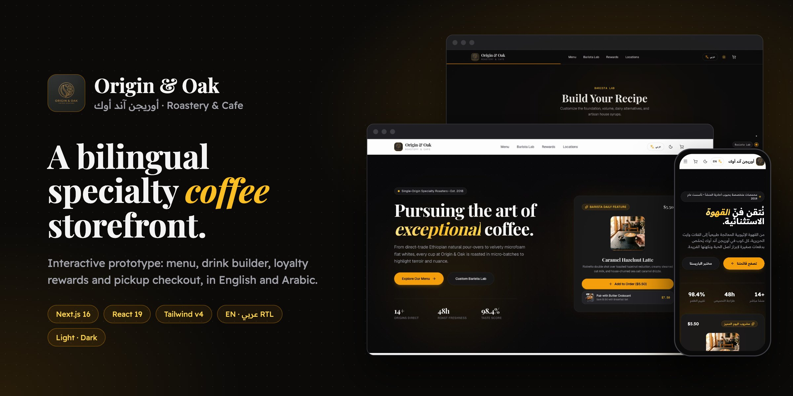
</p>

<h1 align="center">Origin &amp; Oak · أوريجن آند أوك</h1>

<p align="center">
  A bilingual (English / Arabic) storefront prototype for a specialty coffee roaster.<br>
  <strong><a href="https://originandoak.amu3dev.workers.dev/">Live demo</a></strong>
  ·
  <a href="#-screenshots">Screenshots</a>
  ·
  <a href="#-getting-started">Run it locally</a>
</p>

---

## 📌 Project status

**Interactive prototype, deployed and maintained.** Every flow works end to end in the browser, but nothing leaves it:

| Works for real | Demo only |
| :--- | :--- |
| Menu, drink builder, cart, checkout form and order confirmation | No payment, and orders aren't sent anywhere |
| Cart, reward points and preferences saved in your browser (`localStorage`) | No accounts; points are per browser and start at a demo balance of 180 |
| English and Arabic (full right-to-left layout), light and dark mode | Store locations, phone numbers and the map are illustrative |
| Production build deployed to Cloudflare from `main` | Catalog and prices are sample content |

---

## 📸 Screenshots

All captured from the [live site](https://originandoak.amu3dev.workers.dev/).

| | |
| :---: | :---: |
| 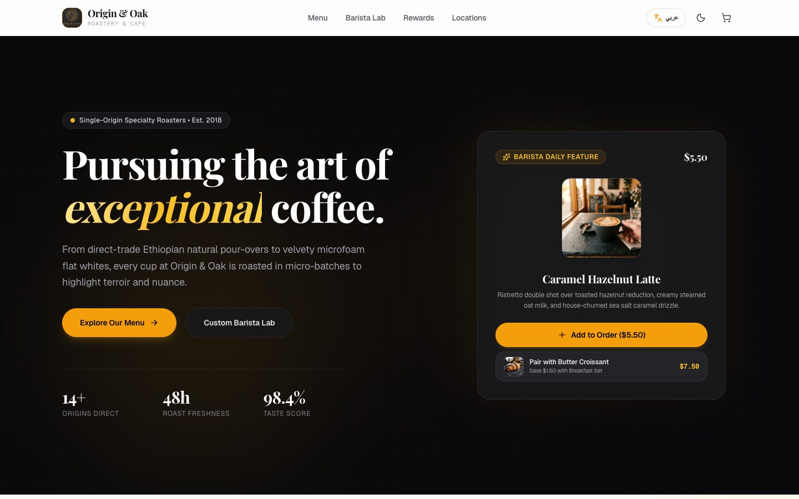<br>**Hero and daily feature** | 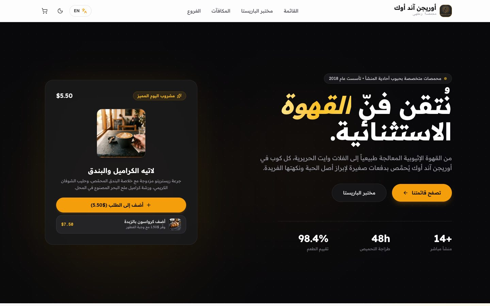<br>**Arabic, right to left** |
| 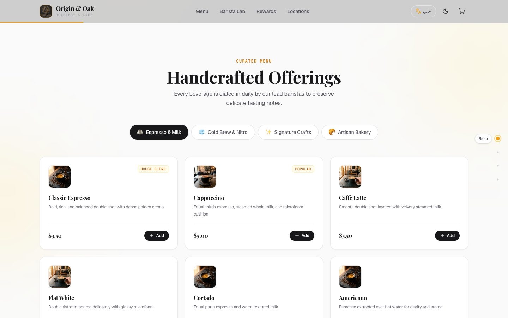<br>**Menu** | 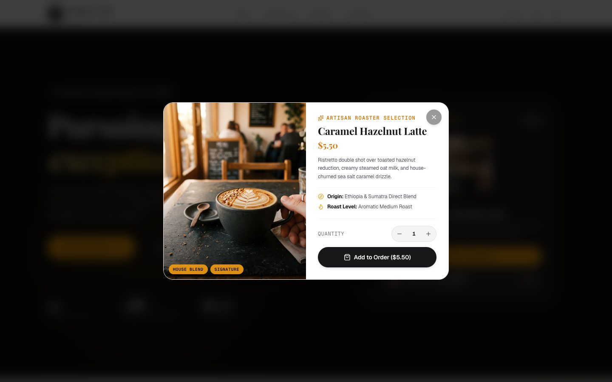<br>**Product details** |
| 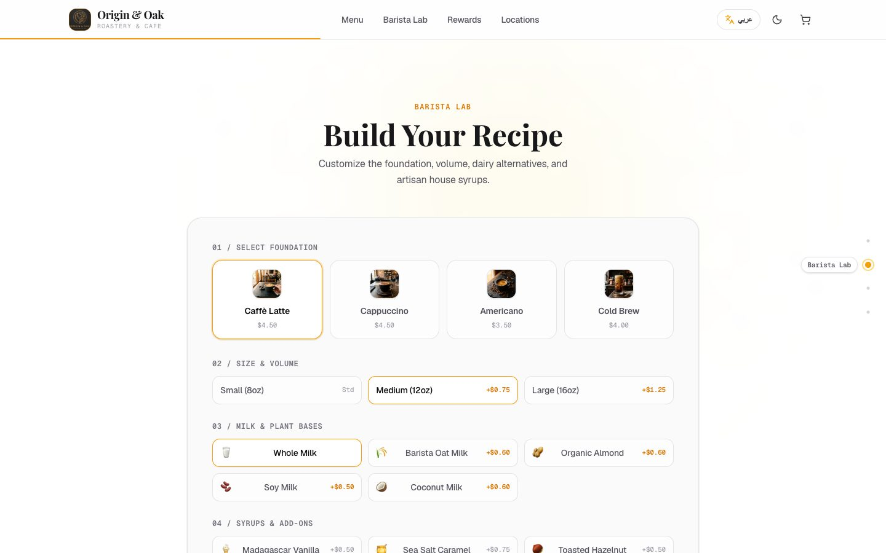<br>**Barista Lab drink builder** | 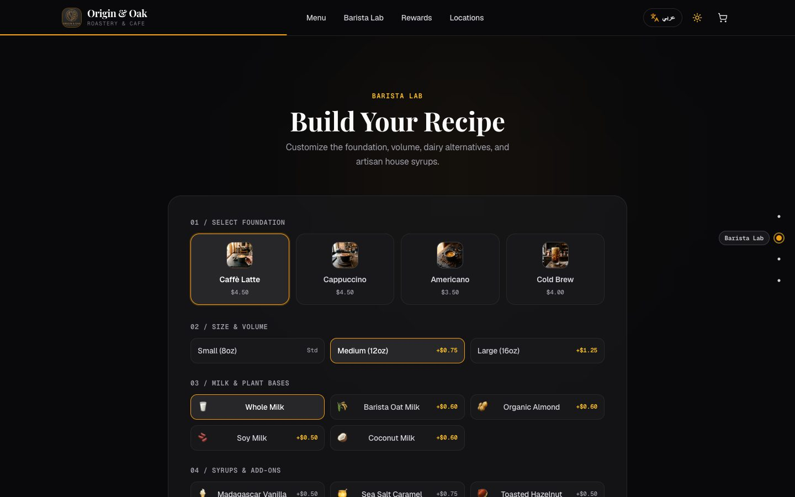<br>**Dark mode** |
| 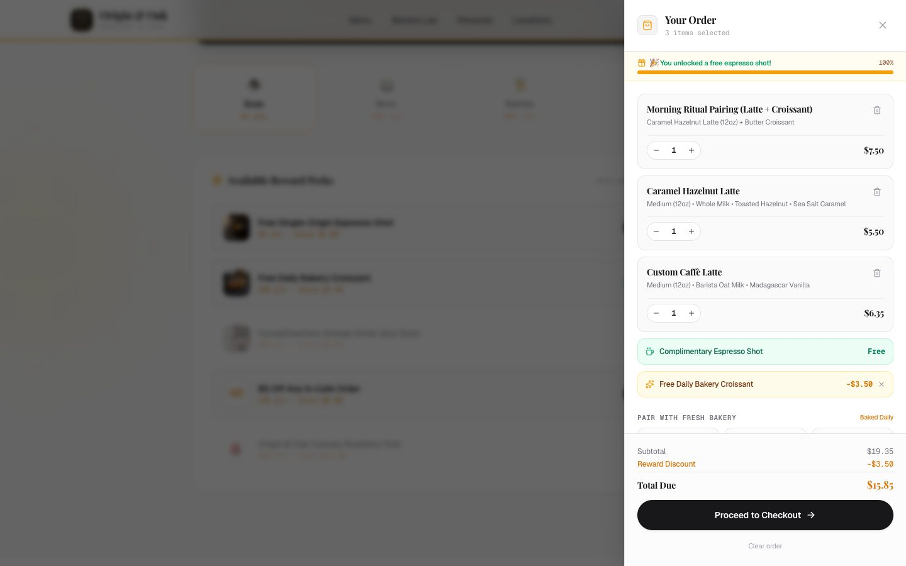<br>**Cart with free espresso and a reward applied** | 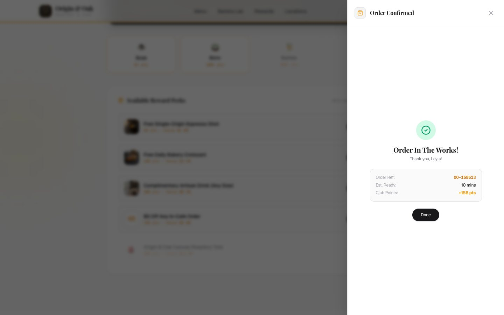<br>**Order confirmation** |
| 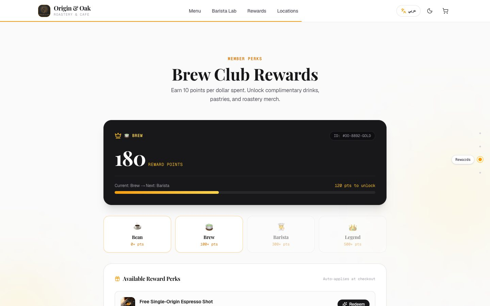<br>**Brew Club rewards** | 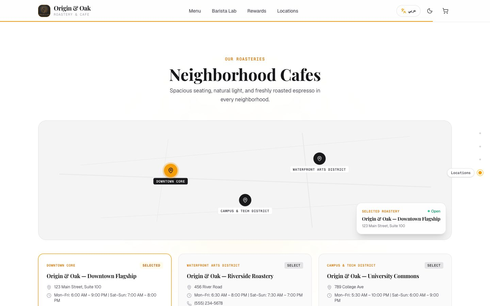<br>**Store locator** |

<p align="center">
  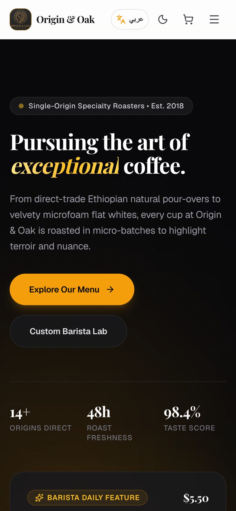
  &nbsp;
  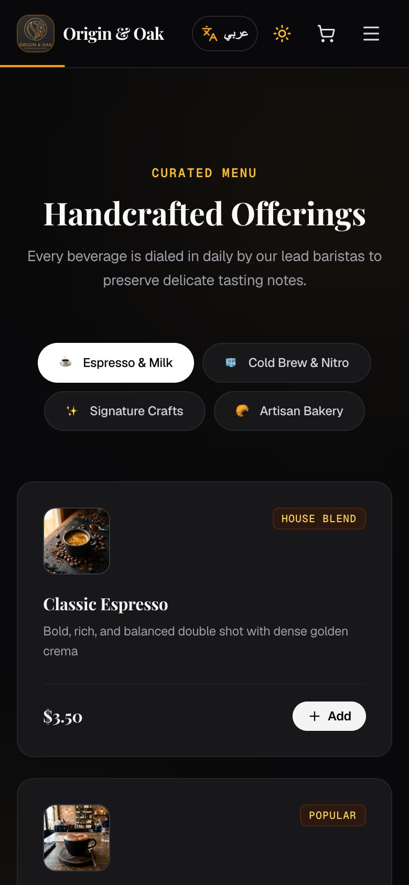
  &nbsp;
  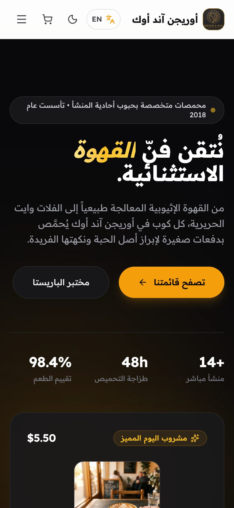
  <br><strong>On a phone: light, dark and Arabic</strong>
</p>

---

## ✨ Features

**Ordering**
- **Menu** in four categories (*Espresso & Milk*, *Cold Brew & Nitro*, *Signature Crafts*, *Artisan Bakery*), with a detail view for each product.
- **Barista Lab:** build a drink from a base, size, milk and add-ons, with a live price and an estimated flavour profile (intensity, sweetness, creaminess).
- **Cart drawer:** adding the same product with the same options increases its quantity instead of adding a duplicate line. Includes one-tap bakery pairings.
- **Free espresso shot** on orders with a subtotal of $15 or more, with a progress bar in the cart.
- **Pickup checkout:** name and store selection, then an order confirmation with a reference number and the points earned.

**Brew Club rewards**
- Earn 10 points per dollar on each order. The balance is kept between visits.
- Redeem perks for a discount on the current order. Swapping or removing a perk refunds its points, and the discount never exceeds the order subtotal.
- Four member tiers (*Bean, Brew, Barista, Legend*) with progress to the next one.

**Language, theme and accessibility**
- Full **English and Arabic** translations, including a right-to-left layout and cart contents that follow the selected language.
- **Light and dark mode**, following the system setting until you choose.
- The saved theme and language are applied before the page first appears, so there's no flash of the wrong theme or direction.
- Dialogs (cart and product details) keep keyboard focus inside, close with Escape, and return focus when closed.
- Scroll animations are turned off when the system's reduced-motion setting is on.

---

## 🛠️ Tech stack

| Layer | Technology |
| :--- | :--- |
| Framework | [Next.js 16](https://nextjs.org/) (App Router, Turbopack), statically exported |
| UI | [React 19](https://react.dev/), [Tailwind CSS v4](https://tailwindcss.com/), [Framer Motion](https://motion.dev/), [Lucide](https://lucide.dev/) icons |
| Language | [TypeScript 5](https://www.typescriptlang.org/) |
| Quality | [ESLint 9](https://eslint.org/), end-to-end tests with [Playwright Core](https://playwright.dev/) |
| Hosting | [Cloudflare Workers](https://workers.cloudflare.com/) static assets |

---

## 📁 Project structure

```
OriginAndOak/
├── src/
│   ├── app/
│   │   ├── layout.tsx              # Fonts, providers, and the pre-paint theme/language script
│   │   ├── page.tsx                # Landing page made of the sections below
│   │   └── globals.css             # Tailwind v4 theme tokens and global styles
│   ├── components/
│   │   ├── Navbar.tsx              # Navigation, language and theme toggles, cart button
│   │   ├── SectionNav.tsx          # Side dots that track the current section
│   │   ├── Hero.tsx                # Hero, daily featured drink and breakfast pairing
│   │   ├── Menu.tsx                # Menu categories and product cards
│   │   ├── ProductDetailModal.tsx  # Product detail dialog
│   │   ├── CustomDrinkBuilder.tsx  # Barista Lab drink builder
│   │   ├── LoyaltyRewards.tsx      # Points, tiers and redeemable perks
│   │   ├── StoreLocator.tsx        # Map and store cards
│   │   ├── Cart.tsx                # Cart drawer, checkout form and confirmation
│   │   └── Footer.tsx
│   └── lib/
│       ├── cart-context.tsx        # Cart, applied reward and points, saved to localStorage
│       ├── i18n.tsx                # English and Arabic dictionaries and the useI18n hook
│       ├── theme-context.tsx       # Light/dark mode
│       ├── preferences.ts          # Storage keys shared with the pre-paint script
│       ├── rewards.ts              # Reward catalog and loyalty rules
│       ├── stores.ts               # Store locations
│       ├── use-dialog-focus.ts     # Focus trap, Escape and scroll lock for dialogs
│       └── use-prefers-reduced-motion.ts
├── scripts/test-e2e.mjs            # End-to-end checks run in Chrome
├── docs/                           # README banner and screenshots
├── public/images/                  # Product photography and logo
└── wrangler.jsonc                  # Cloudflare Workers config
```

---

## 🚀 Getting started

Requires **Node.js 20.9+**.

```bash
git clone https://github.com/amu3dev/OriginAndOak.git
cd OriginAndOak
npm install
npm run dev
```

Then open [http://localhost:3000](http://localhost:3000).

### Scripts

| Command | What it does |
| :--- | :--- |
| `npm run dev` | Development server with hot reload |
| `npm run build` | Production build |
| `npm start` | Serve the production build on port 3000 |
| `npm run lint` | ESLint |
| `npx tsc --noEmit` | TypeScript type check |
| `npm run test:e2e` | End-to-end checks against a running app (see below) |

### End-to-end tests

The e2e script drives Google Chrome through the main flows: ordering, checkout, rewards, saved carts, both languages, keyboard access and dialog focus. Start the app first, then run the tests in a second terminal:

```bash
npm run build && npm start
```

```bash
npm run test:e2e
```

Set `CHROME_PATH` if Chrome isn't in its default location, and `BASE_URL` to test somewhere other than `http://localhost:3000`.

---

## ☁️ Deployment

The live site is a static export served by Cloudflare Workers. Every push to `main` is built and deployed by Cloudflare Workers Builds, and each pull request gets its own preview URL.

To produce the same static output locally:

```bash
CLOUDFLARE_BUILD=1 npm run build
```

This writes the site to `out/`, which `wrangler.jsonc` serves as static assets.

---

## 📄 License

MIT © [Origin & Oak](https://github.com/amu3dev/OriginAndOak)
